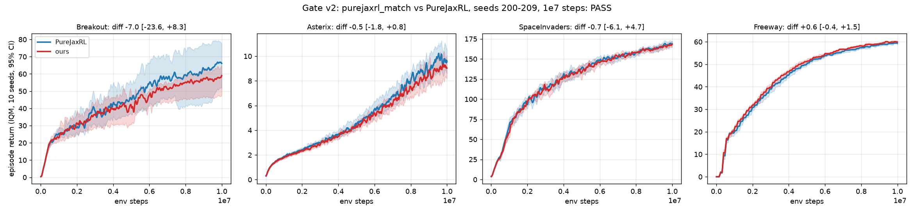

# Baseline gate v2: purejaxrl_match vs unmodified PureJaxRL (4 MinAtar envs)

Rule (`plans/tars-test-rules.md` section 0, locked 23 Oct before the run): seeds 200-209, 1e7 env steps.
Per env, the 95% bootstrap CI of IQM(this repo) - IQM(PureJaxRL) must include 0, AND this repo must not
be lower on all 4 envs. The analysis script `scripts/gate_v2.py` was committed (40aebb8) before
any gate data existed. Final return per seed = mean of the last 10 updates of the end-of-rollout
return (same definition as match_fresh). Bootstrap: 10k resamples within each method, rng seed 0.
No config changes or tuning.

| env | this repo IQM [95% CI] | PureJaxRL IQM [95% CI] | diff [95% CI] | rel. diff | CI contains 0 |
|---|---|---|---|---|---|
| Breakout | 59.04 [47.19, 64.89] | 66.09 [51.24, 78.03] | -7.05 [-23.59, +8.31] | -10.7% | PASS |
| Asterix | 9.04 [8.14, 10.06] | 9.55 [8.59, 10.56] | -0.51 [-1.80, +0.84] | -5.4% | PASS |
| SpaceInvaders | 168.15 [164.62, 172.38] | 168.85 [165.48, 172.45] | -0.71 [-6.14, +4.68] | -0.4% | PASS |
| Freeway | 59.92 [59.24, 60.60] | 59.37 [58.69, 59.97] | +0.55 [-0.36, +1.48] | +0.9% | PASS |

* All four CIs contain 0: **yes**.
* This repo lower on all four: **no** (Freeway is higher). This repo higher on all four: no.
* **Verdict: PASS.**

Notes: this repo is lower on 3 of 4, but each gap is well inside its CI. The largest gap, Breakout
(-10.7%), is where the earlier seed blocks went both ways (100-109: -8.3; pooled: no difference).
Wall clock (5+5 seeds, CPU): this repo 736/1041/840/1874 s vs PureJaxRL 585/845/768/1310 s for
Breakout/Asterix/SpaceInvaders/Freeway. This repo is about 1.1-1.4x slower, mostly from the
truncation-bootstrap critic pass and the per-update health metrics.

